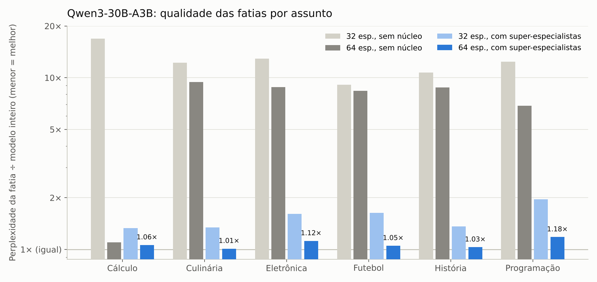
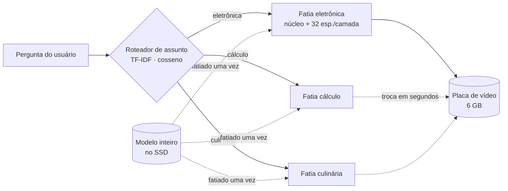
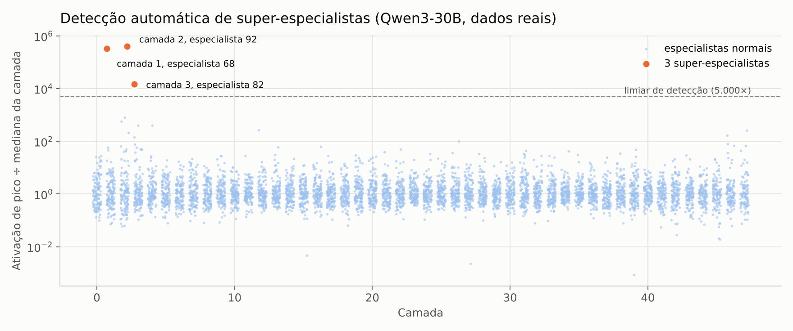
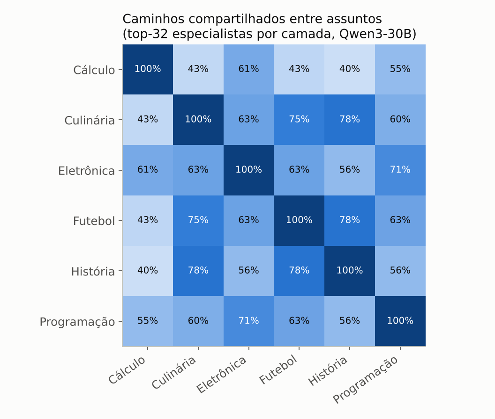
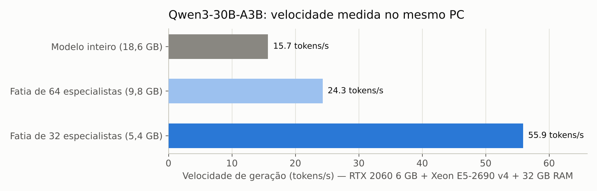
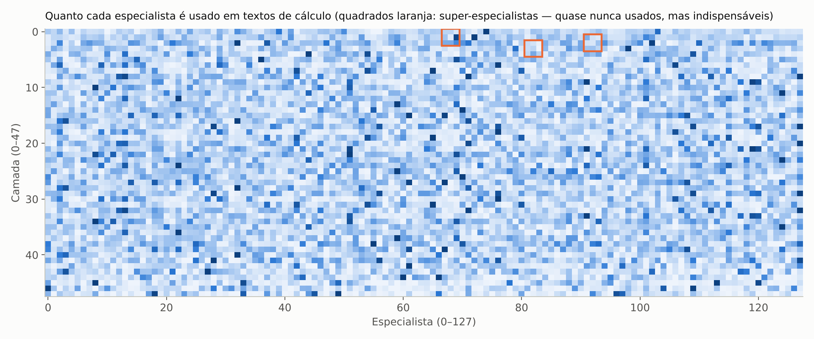

# 🔪 Fatiador — caminhos por assunto em modelos Mixture-of-Experts

> **Rodar modelos de IA gigantes numa placa de vídeo comum carregando só os especialistas do assunto da conversa.**

Uma ideia de pesquisa testada de ponta a ponta num PC doméstico (RTX 2060 com 6 GB, 32 GB de RAM): os modelos *Mixture-of-Experts* (MoE) são **cortados em fatias por assunto**. Cada fatia guarda um **núcleo comum** e só os especialistas que aquele assunto realmente usa. Tudo foi medido em modelos reais (Qwen3-30B-A3B e gpt-oss-120b), com grupo de controle.

<p align="center">
  
</p>

## Resultados em uma tabela

| Modelo | Fatia | Tamanho | Qualidade (vs. modelo inteiro) | Velocidade |
|---|---|---|---|---|
| Qwen3-30B-A3B (inteiro) | — | 18,6 GB | referência | 15,7 tokens/s |
| Qwen3-30B-A3B | **64 de 128 especialistas + núcleo** | 9,8 GB | **só 1% a 18% pior** | 24,3 tokens/s (**1,5×**) |
| Qwen3-30B-A3B | **32 de 128 especialistas + núcleo** | **5,4 GB** (cabe na placa) | 33% a 96% pior | **55,9 tokens/s (3,5×)** |
| gpt-oss-120b (inteiro) | — | 63,4 GB (**o dobro da RAM**) | referência | não roda direito no PC |
| gpt-oss-120b | 32 de 128 especialistas | 17,5 GB | 2,1× pior em texto (cálculo); conversa ainda em ajuste ⚠️ | 10 a 24 tokens/s |
| **Qwen3-30B-A3B** | **🧠 modo plástico: 32 vivos por camada, mudando com a conversa** | 18,6 GB (todos no disco) | **+14% num texto que troca de assunto**, sem calibração | **20,6 tokens/s** (com cache na placa) |
| **Qwen3-235B-A22B (86 GB)** | — | **86 GB (2,7× a RAM)** | referência | 0,69 tokens/s |
| **Qwen3-235B-A22B** | **🧠 modo plástico: 32 vivos por camada** | 86 GB, ~20 GB vivos | **+17,7%**; matemática perfeita, conhecimento de nicho sofre | **2,8 tokens/s (4×)** |

*Qualidade medida por perplexidade em artigos da Wikipédia **diferentes** dos usados para calibrar. Os 6 assuntos são cálculo, culinária, eletrônica, futebol, história e programação.*

---

## 💡 A ideia

Um modelo MoE tem, em cada camada, dezenas de "especialistas" (pequenas redes), e um **roteador** escolhe alguns deles para cada palavra. O Qwen3-30B tem 128 especialistas por camada e usa 8 por vez. Em vez de manter todos na memória, a ideia é:

1. **Medir** quais especialistas cada assunto realmente usa;
2. **Cortar** o modelo em fatias: **núcleo comum** (atenção, embeddings, normalizações, *super-especialistas*) + **os especialistas favoritos do assunto**;
3. **Carregar só a fatia** da conversa atual e **trocar de fatia** quando o assunto muda, como um cérebro que ativa só as regiões que importam.



## 📐 A matemática

**Roteador como geometria.** Numa camada com especialistas $`e_1,\dots,e_N`$, o roteador tem um vetor $`w_i`$ por especialista. Para uma palavra com estado oculto $`h`$, o roteador calcula

```math
s_i = w_i \cdot h, \qquad \text{usados} = \mathrm{top}_k(s_1,\dots,s_N)
```

Ou seja, cada especialista "manda" num **cone** do espaço, e a palavra usa os $`k`$ especialistas que apontam mais perto dela. Um **assunto** é uma *nuvem* de pontos nesse espaço.

**Fatia.** Para o assunto $`t`$, contamos em cada camada $`\ell`$ quantas vezes cada especialista foi escolhido, $`c^{(t)}_{\ell,i}`$, e mantemos

```math
S^{(t)}_\ell = \mathcal{N}_\ell \;\cup\; \mathrm{top}_{M - |\mathcal{N}_\ell|}\big(c^{(t)}_{\ell,1},\dots,c^{(t)}_{\ell,N}\big)
```

em que $`\mathcal{N}_\ell`$ é o **núcleo** (super-especialistas) e $`M`$ é o tamanho da fatia (32 ou 64). O roteador da fatia só enxerga $`S^{(t)}_\ell`$: se a palavra "queria" um especialista cortado, ela usa o próximo mais próximo dentro da fatia.

**Cobertura** (quanto a fatia cobre do que o assunto usa):

```math
\text{cobertura}^{(t)} = \frac{1}{L}\sum_\ell \frac{\sum_{i\in S^{(t)}_\ell} c^{(t)}_{\ell,i}}{\sum_i c^{(t)}_{\ell,i}}
```

**Detecção automática de super-especialistas.** O `llama-imatrix` guarda, por especialista, a soma dos quadrados das ativações que entram na projeção `down`. Dividindo pelo número de vezes que ele foi usado, temos a ativação de pico típica $`a_{\ell,i}`$:

```math
\rho_{\ell,i} = \frac{a_{\ell,i}}{\mathrm{mediana}_j\, a_{\ell,j}} > 5000 \;\Rightarrow\; \text{super-especialista} \Rightarrow \text{entra no núcleo}
```

**Velocidade com cache** (proposta da próxima etapa). Se uma fração $`m`$ das escolhas cair fora da placa e for atendida pela RAM, o tempo por palavra fica entre os dois extremos medidos:

```math
\frac{1}{v(m)} = \frac{m}{v_{\text{RAM}}} + \frac{1-m}{v_{\text{GPU}}}, \qquad v_{\text{RAM}} = \text{15,8}, \quad v_{\text{GPU}} = \text{72,4 tokens/s}
```

Com $`m = 20\%`$, a estimativa é de ~42 tokens/s, com **a mesma qualidade do modelo inteiro**.

---

## 🔬 Descobertas

### 1. Os caminhos por assunto existem (com grupo de controle)
Nos 12 testes do Qwen3, a fatia do **assunto certo** sempre ganhou da fatia de **outro assunto**. No gpt-oss-120b o efeito é ainda mais forte: em cálculo, a fatia certa ficou em **17,5** de perplexidade e a errada em **149**.

### 2. Super-especialistas: 3 especialistas em 6.144 decidem tudo
As primeiras fatias **desmoronaram** (perplexidade 10 a 17 vezes pior). A causa: o Qwen3-30B tem **3 "super-especialistas"** (camada 1/especialista 68, camada 2/92 e camada 3/82) que quase nunca são escolhidos, mas sem os quais o modelo quebra. Eles ficavam entre a 62ª e a 123ª posição no ranking de uso e eram sempre cortados. Colocando os três no **núcleo**, a fatia de 64 especialistas passou de **6 a 9 vezes pior** pra **só 1% a 18% pior**.

<p align="center"></p>

### 3. Dá pra achar os super-especialistas automaticamente
A ativação de pico deles é de **15 mil a 400 mil vezes** maior que a dos outros especialistas da camada, e nenhum outro passa de mil. O detector encontrou **exatamente** os 3 relatados na literatura (Su et al., 2025), sem nenhuma lista prévia. No gpt-oss-120b ele **não encontrou nenhum**: nem todo MoE tem super-especialistas.

### 4. Assuntos técnicos têm caminhos mais próprios
<p align="center"></p>

Cálculo compartilha só **40 a 61%** dos especialistas favoritos com os outros assuntos. Culinária, futebol e história compartilham **75 a 78%** entre si: é a "linguagem do dia a dia". A ideia funciona melhor justamente onde especialização importa.

### 5. O formato de conversa também faz parte do núcleo
Calibrando só com texto de enciclopédia, a fatia do gpt-oss entendia o assunto (perplexidade razoável), mas **se perdia ao conversar**: gerava "… … …" e nunca chegava à resposta final. Os especialistas do **formato de chat** (marcadores `<|channel|>`, fase de raciocínio) tinham sido cortados. Daí veio o `6_calibrar_chat.py`, que calibra com conversas no formato do próprio modelo (em teste).

### 6. Velocidade

<p align="center"></p>

<p align="center"></p>

---

## 🧠 Fase 2: o modo cérebro (sem assuntos, sem calibração)

As fatias por assunto têm um defeito: alguém precisa decidir os assuntos e calibrar com textos. A segunda fase tira isso: **cada especialista é um neurônio com uma força de conexão** que sobe quando o roteador o escolhe e decai com o tempo (meia-vida). As conexões fortes ficam vivas, as fracas são cortadas, e o modelo muda de forma durante a conversa.

```math
s_e(t) = s_e(t_0)\,2^{-(t-t_0)/\tau} + w_e(t), \qquad \text{vivos}_\ell = \text{top}_N\big(s_{\ell,e}\big) \cup \text{vitais}_\ell
```

### 7. Motor próprio em Python, com memória em 3 níveis (`fatiador/cerebro/`)
Um motor Qwen3-MoE escrito do zero (lê o GGUF, descomprime Q2_K–Q8_0 na GPU, confere com o Transformers com erro de 7×10⁻⁶): os especialistas fortes moram na **VRAM**, os médios na **RAM** e os fracos no **SSD**, com um mapa ao vivo das conexões nascendo e morrendo.

- **Ele achou os super-especialistas sozinho, enquanto conversava**, medindo o pico de ativação: no Qwen3-30B, exatamente os 3 do artigo (1/68, 2/92, 3/82, picos de 1.300 a 1.900× a mediana). No **Qwen3-235B, que o artigo não testou, achou 2: camada 2/especialista 39 e camada 3/especialista 120** (picos de 3.000 a 6.000×). *Preliminar: só 2 perguntas.*
- Velocidade, com honestidade: 1,7 tokens/s no 30B e 0,1 no 235B. O PyTorch não tem os kernels comprimidos do llama.cpp; serviu de laboratório.

### 8. O llama.cpp chegou à mesma ideia, e medimos
Em novembro de 2026 o llama.cpp ganhou o `--moe-cache-mib`: especialistas usados com frequência ficam num cache na placa, com uma força que soma 1 por uso e cai pela metade a cada 128 tokens: **o mesmo reforço com esquecimento**, chegando independentemente à mesma solução.

| | Qwen3-30B | Qwen3-235B |
|---|---|---|
| normal (especialistas na RAM) | 16,1 tok/s | 0,73 tok/s |
| cache na placa, faltas **enviadas** pra placa (padrão) | 11,6 ❌ | 0,30 ❌ |
| cache na placa, faltas **calculadas no processador** (`--moe-cache-cpu-share 1`) | **18,2–19,9** ✅ | 0,68 |

O cache exato não ajuda o 235B: com 86 GB num PC de 32 GB, o gargalo é o **SSD**, não onde o especialista é calculado.

### 9. Modo plástico no llama.cpp (fork) — a parte nova
No [fork do llama.cpp](https://github.com/thiagobueno5569/llama.cpp/tree/cerebro) (`src/llama-moe-plastic.cpp`), o **roteador de cada camada só pode escolher entre os especialistas vivos** (uma máscara de 0/−∞ somada às notas do roteador). Os outros **nunca são lidos**, então um modelo maior que a RAM roda sem esperar o disco depois de aquecer. Tudo o que estudamos entra junto:

| Conceito | No código |
|---|---|
| Força com esquecimento | soma do peso do roteador, meia-vida de 512 tokens |
| O que o modelo **queria** | o roteador sem máscara roda em paralelo; é ele que decide as forças |
| Recrutamento | um especialista morto que o roteador quer com peso ≥ 0,2 entra na hora |
| Neurônios vitais | `--moe-plastic-vital 1:68,2:92,3:82` nunca são cortados |
| Núcleo | as primeiras 4 camadas MoE ficam inteiras |
| Susto da novidade | uma pergunta que a fatia cobre bem pior que o normal apaga as forças antigas |
| Dormir | `--moe-plastic-memory` salva as forças e começa a próxima sessão com elas |
| Pré-carregamento | uma thread lê do disco os especialistas que acabaram de nascer |

**Qualidade (Qwen3-30B, texto misto de 6 assuntos em sequência, sem nenhuma calibração):**

| Especialistas vivos por camada | Piora da perplexidade | Cobertura do que o roteador queria |
|---|---|---|
| 64 de 128 | **+3,2%** | 93,8% |
| 48 | +7,1% | 87,8% |
| 32 (com o susto da novidade) | **+14,0%** | 78,9% |
| 32 **sem vitais e sem núcleo** | **+105%** ❌ | 76,7% |
| 16 | +60,9% | 59,7% |
| *fatia fixa de 32 por assunto (fase 1)* | *+33% a +96%* | — |

**Descobertas desta fase:**
1. **Os neurônios vitais e o núcleo valem 6 vezes a qualidade**: a mesma fatia de 32 vai de +14% para +105% sem eles.
2. **Fatia que muda vence fatia fixa**: 32 dinâmicos (+14%) contra 32 fixos com o assunto certo (+33% a +96%), e sem precisar saber o assunto.
3. **Cobertura não é tudo**: dividir o orçamento entre as camadas pela cobertura subiu a cobertura (78,9% → 80%) mas **piorou** a perplexidade (+14% → +20%). As camadas concentradas ficaram com pouco.
4. **O que o 235B perde é conhecimento de nicho**: com 32 vivos a matemática e a eletrônica saem perfeitas, mas a receita de pão de queijo saiu inventada. Com 40 vivos, quase certa. Raciocínio é amplo; fatos raros moram em especialistas raros.
5. **O susto da novidade não recupera fatos raros**: na versão final (mesmo número por camada + novidade), o 235B com 32 vivos faz 2,64 tok/s e acerta derivada, integral, capacitor e lei de Ohm, mas ainda chama polvilho de "farinha de milho". Com 40 (2,14 tok/s), erra a origem do pão de queijo e solta um token estranho no meio de uma conta. O especialista que guarda o fato não chega a ser recrutado a tempo: a resposta começa antes.

**Velocidade:**

| | Normal | Modo plástico |
|---|---|---|
| Qwen3-30B (com cache na placa) | 19,2 tok/s | **20,6 tok/s** |
| Qwen3-235B (86 GB num PC de 32 GB) | 0,69 tok/s | **2,8 tok/s (4×)** |
| Qwen3-235B, perplexidade de 4 mil tokens | 27 min | **13 min**, +17,7% |

```text
llama-server -m Qwen3-235B-A22B-Instruct-2507-Q2_K-00001-of-00002.gguf -ngl 99 --n-cpu-moe 94 -fa on ^
  --moe-plastic 32 --moe-plastic-vital 2:39,3:120 --moe-plastic-memory memoria-235b.txt
```

---

## 🧪 Simulações (antes dos modelos reais)

A ideia começou numa simulação do zero em NumPy (`simulacoes/`):

| Experimento | Resultado |
|---|---|
| `experimento_blocos.py`: matriz em blocos por assunto vs. rede densa (mesmo nº de parâmetros) | mesma acurácia (91,4% vs. 90,5%) com **6,5× menos multiplicações** |
| Mesmo experimento, aprendendo um assunto de cada vez | a rede densa **esqueceu** os primeiros assuntos (média de 63%); a de blocos manteve **92% em todos** (sem *esquecimento catastrófico*) |
| `experimento_cerebro.py`: núcleo + blocos com memória em 3 níveis (VRAM → RAM → SSD), com perda de bits quando "esquecidos" | modelo de 14 GB ocupando só **5 GB na placa**; **relembrar** um assunto esquecido foi **1,2 a 4,5× mais rápido** que aprender do zero (6 sementes) |

---

## 🚀 Como rodar (Windows)

Pré-requisitos: Python 3.11+, uma placa NVIDIA e um modelo MoE em GGUF (testado com Qwen3-30B-A3B Q4_K_M e gpt-oss-120b MXFP4).

```text
fatiador\RODAR.bat -Manter 64     # baixa textos, mede caminhos, fatia e compara (llama.cpp CUDA é baixado sozinho)
fatiador\CONVERSAR.bat            # app de conversa: escolhe a fatia pelo assunto e mostra tudo graficamente
fatiador\GPTOSS_V2.bat            # experimento com o gpt-oss-120b (63 GB), calibrado com conversas
```

| Script | O que faz |
|---|---|
| `0_baixar_textos.py` | Baixa artigos da Wikipédia por assunto (calibração e avaliação **separadas**) |
| `1_medir_especialistas.py` | Roda o `llama-imatrix`, conta o uso de cada especialista por camada e **detecta super-especialistas** |
| `2_fatiar_gguf.py` | Gera um GGUF por assunto: núcleo + top-M especialistas (lê o modelo direto do disco, sem precisar de GPU) |
| `3_comparar.py` | Perplexidade (inteiro × fatia certa × fatia errada), velocidade e tamanho |
| `4_ajuste_fino.py` | Ajuste fino só dos roteadores com uma **força de agrupamento por assunto** (IBM Granite 3.1 1B-A400M) |
| `5_conversar.py` + `conversar.html` | App web: roteador de assunto, troca de fatia, mapa 48×128 dos especialistas ligados, velocidade ao vivo |
| `6_calibrar_chat.py` | Calibração no formato de conversa do modelo (harmony / chatml) |
| `7_testar_conversa.py` | Faz perguntas reais a cada fatia e detecta quando ela "desmonta" |
| `baixar_modelo.py` | Download paralelo (8 conexões) com retomada e conferência de SHA-256 |
| `8_calibrar_latex.py` | Calibração com exercícios de cálculo em LaTeX gerados e conferidos pelo SymPy |
| `cerebro/` | **Modo cérebro em Python**: motor Qwen3-MoE próprio, memória VRAM/RAM/SSD, detector de neurônios vitais, app com mapa ao vivo |
| `bench_cache.py` | Mede o llama.cpp normal × `--moe-cache-mib` |
| `avaliar_plastico.py` | Avalia o **modo plástico** do fork: perplexidade e conversas reais (30B e 235B) |

**Hardware dos testes:** Xeon E5-2690 v4 (14 núcleos), 32 GB de DDR4 (2 de 4 canais), RTX 2060 6 GB, SSD SATA → NVMe WD SN750 SE.

## 📁 Estrutura

```
fatiador/      código do pipeline e do app
simulacoes/    os experimentos iniciais em NumPy
resultados/    tabelas e contagens de especialistas medidas (Qwen3-30B e gpt-oss-120b)
docs/img/      gráficos gerados a partir dos dados reais
```

## ⚖️ Limitações (com honestidade)

- **Perplexidade não é tudo:** é uma medida de texto corrido. A descoberta 5 mostra que uma fatia pode ter perplexidade razoável e mesmo assim conversar mal. Os testes de conversa (`7_testar_conversa.py`) entram justamente pra isso.
- **6 assuntos, ~30 artigos cada:** é pouco pra conclusões gerais. A escolha da fatia por TF-IDF é simples de propósito.
- **Modelos prontos não foram treinados para isso:** os especialistas não se organizam por assunto humano. A proposta forte é **treinar** (ou ajustar) com roteamento por assunto (`4_ajuste_fino.py`).
- **Modo plástico:** perplexidade num texto de ~20 mil tokens (30B) e ~4 mil (235B), e 5 perguntas por conversa. Os neurônios vitais do 235B saíram de só 2 perguntas.
- **Conhecimento raro sofre** com poucos especialistas vivos (ver descoberta 4 da fase 2).

## 🗺️ Próximos passos

- [ ] Resultado do teste de conversa do gpt-oss calibrado com chat (32 × 64 especialistas)
- [ ] Ajuste fino dos roteadores com força de agrupamento (Granite), medindo antes e depois
- [x] Cache por conversa: fatia na placa, faltas no processador (o llama.cpp já faz: `--moe-cache-mib`, ~+20% no 30B)
- [x] Fatia que muda com a conversa (modo plástico no fork do llama.cpp)
- [ ] Recrutamento por "dúvida": abrir mais especialistas quando o roteador está indeciso (fatos raros)
- [ ] Detectar os neurônios vitais dentro do llama.cpp (hoje vêm do motor em Python)
- [ ] Mais assuntos, e um roteador de assunto por embeddings
- [ ] Curva completa qualidade × tamanho (16, 24, 32, 48, 64, 96)

## 📚 Trabalhos relacionados

- Su et al. (2025), *Unveiling Super Experts in Mixture-of-Experts LLMs*, [arXiv:2507.23279](https://arxiv.org/abs/2507.23279), ICLR 2026
- Dong et al. (2025), *Domain-Specific Pruning of Large MoE Models with Few-shot Demonstrations* (EASY-EP), [arXiv:2504.06792](https://arxiv.org/abs/2504.06792)
- Eliseev & Mazur (2023), *Fast Inference of Mixture-of-Experts Language Models with Offloading*
- Song et al. (2023), *PowerInfer*: neurônios "quentes" na GPU e "frios" na CPU (divisão fixa)
- llama.cpp `--moe-cache-mib` (2026): cache de especialistas com força que decai, a mesma ideia do modo cérebro, chegada de forma independente
- Aljundi et al. (2017), *Expert Gate: Lifelong Learning with a Network of Experts*
- Martinetz & Schulten (1991), *Neural Gas*; Kohonen (1982), *Self-Organizing Maps*
- [llama.cpp](https://github.com/ggml-org/llama.cpp): `llama-imatrix`, `llama-perplexity`, `llama-server`

## 👤 Autor

**Thiago Bueno da Silva**, estudante de Engenharia Elétrica na UFSJ. Ideia original: matrizes divididas em blocos/vetores por assunto, com um núcleo comum, especialistas que se fortalecem com o uso e uma hierarquia de memória (VRAM → RAM → SSD), pra que um modelo enorme rode numa placa comum.

Desenvolvido com a ajuda do Claude (Anthropic) na implementação e nas medições.

Licença: [MIT](LICENSE).
